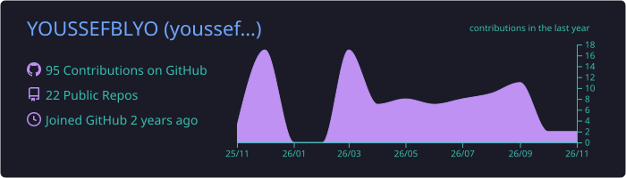
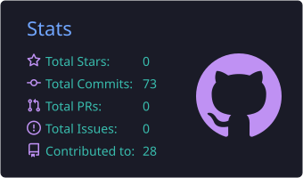
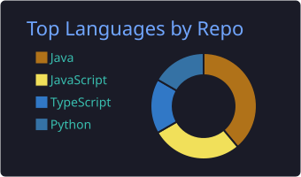
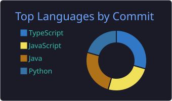
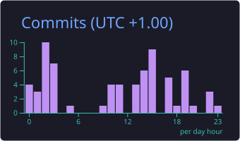

<!-- ============ EN-TÊTE ANIMÉ ============ -->
<p align="center">
  
</p>

<p align="center">
  <a href="https://github.com/YOUSSEFBLYO">
    
  </a>
</p>

<p align="center">
  
  <a href="https://github.com/YOUSSEFBLYO?tab=followers"></a>
  <a href="https://github.com/YOUSSEFBLYO?tab=repositories"></a>
</p>

---

## 👨‍💻 À propos

```java
public class YoussefBelghali {
    String role       = "Développeur Full-Stack";
    String[] backend  = {"Java", "Spring Boot", "Spring Security", "Spring AI", "Kafka", "Python", "Django"};
    String[] frontend = {"Angular", "Next.js", "React", "TypeScript"};
    String[] devops   = {"Docker", "GitHub Actions", "CI/CD", "Linux"};
    String focus      = "Architectures microservices & applications temps réel";
    String motto      = "Apprendre en construisant.";
}
```

- 🔭 Je construis des **architectures microservices** (Spring Boot, Kafka, Spring Cloud)
- 🤖 J'explore **Spring AI + MCP** pour brancher des agents IA sur des bots Telegram / Discord
- ⚡ J'aime le **temps réel** : WebSocket, STOMP, suivi de colis en direct
- 🐳 Je containerise tout avec **Docker** et j'automatise avec **GitHub Actions**

---

## 🛠️ Stack technique

<p align="center">
  
  <br/>
  
  <br/>
  
</p>

---

## 🚀 Projets à la une

<table>
<tr>
<td width="50%" valign="top">

### 🏦 [Digital Banking](https://github.com/YOUSSEFBLYO/digital-banking)
Application bancaire full-stack : gestion des clients, comptes et opérations.


</td>
<td width="50%" valign="top">

### 📦 [Shipment Tracker](https://github.com/YOUSSEFBLYO/Shipment-tracker)
Suivi de colis **en temps réel** via WebSocket / STOMP.


</td>
</tr>
<tr>
<td width="50%" valign="top">

### 🔀 [Workflow Builder](https://github.com/YOUSSEFBLYO/workflow-builder)
Éditeur visuel de workflows, avec son [backend Python](https://github.com/YOUSSEFBLYO/workflow-backend).


</td>
<td width="50%" valign="top">

### 🧩 [Java Spring Microservices](https://github.com/YOUSSEFBLYO/java-spring-microservices)
Architecture microservices conteneurisée (services patients, API gateway…).


</td>
</tr>
<tr>
<td width="50%" valign="top">

### 📱 [Taetir App](https://github.com/YOUSSEFBLYO/Taetir-app)
Application web TypeScript conteneurisée avec Docker.


</td>
<td width="50%" valign="top">

### 🐳 [DevOps Level 1](https://github.com/YOUSSEFBLYO/DEVOPS-LEVEL1)
Bases DevOps : conteneurisation et pipeline de déploiement.


</td>
</tr>
</table>

---

## 📊 Statistiques GitHub

<p align="center">
  
</p>

<p align="center">
  
  
</p>

<p align="center">
  
  
</p>

<p align="center">
  
</p>

---

## 🐍 Mes contributions… dévorées

<p align="center">
  <picture>
    <source media="(prefers-color-scheme: dark)" srcset="https://raw.githubusercontent.com/YOUSSEFBLYO/YOUSSEFBLYO/output/github-snake-dark.svg"/>
    <source media="(prefers-color-scheme: light)" srcset="https://raw.githubusercontent.com/YOUSSEFBLYO/YOUSSEFBLYO/output/github-snake.svg"/>
    
  </picture>
</p>

---

<p align="center">
  
</p>
